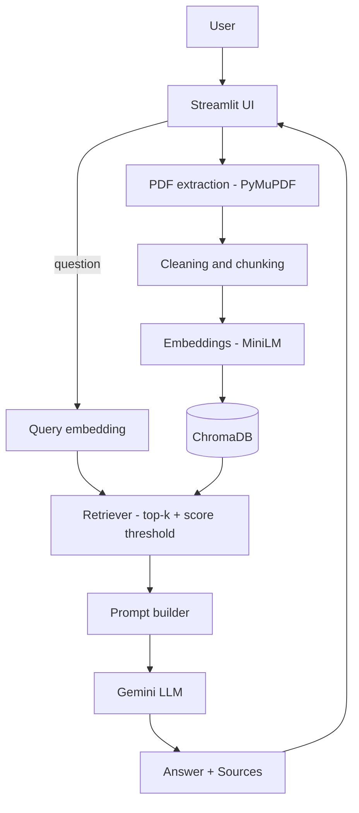

# DocuMind AI

A document question-answering app built on Retrieval-Augmented Generation (RAG). Upload PDFs, ask questions in plain language, and get answers generated from the documents, with page-level source citations.

## Overview

DocuMind AI extracts text from PDFs, splits it into chunks, stores embeddings in ChromaDB, retrieves the chunks most relevant to each question, and asks Gemini to answer using only those chunks. If the documents do not contain the answer, the app says so instead of guessing.

## Problem Statement

LLMs do not know the contents of your private files, and when asked about them they tend to produce confident but unsupported answers. Reading long PDFs manually is slow, and a plain chatbot gives you no way to check where an answer came from.

## Solution

Retrieval first, generation second. The model only sees passages retrieved from your documents, is instructed to answer from them alone, and every answer is shown with the document and page it relied on, plus the excerpts themselves, so claims can be verified.

## Features

- Upload one or several PDFs, with name, size and status shown for each
- Validation for invalid files, corrupted or password-protected PDFs, scanned PDFs with no text, oversized files and duplicates
- Chat with conversation history, suggested questions, and a clear-conversation button
- Source citations (document and page) with expandable excerpts and similarity scores
- Multi-document questions, with per-document retrieval so one file cannot crowd out another
- Choose which documents are searched
- Summaries: short summary, key points, important findings
- Document panel: document, page and chunk counts and status
- Friendly errors for a missing or invalid API key, rate limits, network failures, empty retrieval and database failures
- Configurable models, chunking and retrieval through environment variables

## Architecture



## Tech Stack

| Layer | Choice | Why | Alternatives |
|---|---|---|---|
| UI | Streamlit | Fast to build, pure Python | Gradio, Next.js + FastAPI |
| PDF parsing | PyMuPDF | Fast, accurate page-level text | pypdf, pdfplumber, Unstructured |
| Chunking | LangChain `RecursiveCharacterTextSplitter` | Splits on paragraph/sentence boundaries first | Semantic chunking, token-based splitters |
| Embeddings | `sentence-transformers/all-MiniLM-L6-v2` (about 90 MB, 384 dims) | Small, free, runs on CPU | Gemini embeddings, OpenAI, BGE-small |
| Vector DB | ChromaDB | Zero setup, local, metadata filters | Pinecone, Qdrant, pgvector, FAISS |
| LLM | Gemini (`gemini-2.5-flash` by default) | Free tier, fast, large context | OpenAI, Claude, local models via Ollama |
| Orchestration | LangChain (core pieces only) | Standard interfaces for splitter, vector store, LLM | Direct SDK calls |

## RAG Workflow

1. **Extract**: PyMuPDF reads each page. Text is cleaned (hyphenated line breaks re-joined, whitespace normalised). Pages without text are skipped but counted.
2. **Chunk**: each page is split into about 1000-character chunks with 150 characters of overlap. Every chunk keeps `filename`, `page`, `doc_id`, `chunk_id`.
3. **Embed and store**: each chunk becomes a 384-dimension vector, saved in ChromaDB (cosine space) with its metadata.
4. **Retrieve**: the question is embedded the same way, and the nearest chunks are fetched (top 5 by default). Chunks below a similarity threshold are dropped. With several documents, each is searched separately and results are merged.
5. **Generate**: retrieved chunks are placed in a prompt (`rag/prompts.py`) that tells Gemini to use only that context and to reply with a fixed "not found" sentence otherwise.
6. **Cite**: the retrieved chunks are shown as sources. If nothing relevant is retrieved, the LLM is not called at all.

### Chunking parameters

- **1000 characters (about 150–200 words)**: large enough to hold a complete idea, small enough that the embedding stays focused and the prompt stays short. MiniLM also truncates input at 256 word-pieces, so much larger chunks would silently lose text.
- **150 characters overlap (15%)**: keeps sentences that straddle a boundary retrievable.
- **Split per page**: chunks never cross pages, which makes the page citation exact. The cost is that an idea spanning a page break is split.
- These are sensible starting values, not tuned ones. Change `CHUNK_SIZE` / `CHUNK_OVERLAP` and compare results on your own documents.

## Installation

Requires Python 3.10+ (3.11 or 3.12 recommended).

```bash
git clone https://github.com/<your-username>/documind-ai.git
cd documind-ai
python -m venv .venv
source .venv/bin/activate          # Windows: .venv\Scripts\activate
pip install -r requirements.txt
cp .env.example .env               # then edit .env
```

Get a free key at <https://aistudio.google.com/apikey>.

## Environment Variables

| Variable | Default | Purpose |
|---|---|---|
| `GOOGLE_API_KEY` | none (required) | Gemini API key |
| `GEMINI_MODEL` | `gemini-2.5-flash` | Model name. If Google retires it, set a current one |
| `EMBEDDING_MODEL` | `sentence-transformers/all-MiniLM-L6-v2` | Any sentence-transformers model |
| `CHROMA_PERSIST_DIR` | `data/chroma` | Empty = in-memory only |
| `CHUNK_SIZE` / `CHUNK_OVERLAP` | `1000` / `150` | Chunking |
| `TOP_K` | `5` | Chunks retrieved per question |
| `SCORE_THRESHOLD` | `0.2` | Minimum cosine similarity (0–1) |
| `MAX_FILE_MB` / `MAX_DOCUMENTS` | `25` / `5` | Upload limits |

Note: if you raise `MAX_FILE_MB` above 25, also raise `maxUploadSize` in `.streamlit/config.toml`.

## Running Locally

```bash
streamlit run app.py
```

The first document you process downloads the embedding model (about 90 MB) once.

Tests (no API key or model download needed, they use a fake embedder and fake LLM):

```bash
pip install -r requirements-dev.txt
pytest
```

## Deployment

### Streamlit Community Cloud

1. **GitHub**: create an empty repository, then
   ```bash
   git init && git add . && git commit -m "Initial commit"
   git branch -M main
   git remote add origin https://github.com/<your-username>/documind-ai.git
   git push -u origin main
   ```
   Check that `.env` is not in the commit (`git ls-files | grep .env` should show only `.env.example`).
2. Go to <https://share.streamlit.io>, sign in with GitHub, click **Create app**, choose the repository, branch `main`, main file `app.py`.
3. Open **Advanced settings**: choose Python 3.11 or 3.12, and paste your secrets in TOML format:
   ```toml
   GOOGLE_API_KEY = "your_key_here"
   CHROMA_PERSIST_DIR = ""
   ```
4. Click **Deploy**. Top-level secrets are exposed to the app as environment variables, which is where `config/settings.py` reads them.

### Common deployment problems

- **Build is slow or runs out of memory**: `sentence-transformers` pulls in PyTorch. Free-tier resources are limited; if the build fails, try the CPU-only torch wheel or switch `EMBEDDING_MODEL` to a hosted embedding API.
- **First question after a cold start is slow**: the app sleeps when idle and re-downloads the embedding model when it wakes.
- **"No Gemini API key found"**: the secret name must be exactly `GOOGLE_API_KEY`.
- **Quota / rate-limit message**: the free Gemini tier has per-minute and per-day limits. Wait or use another key.
- **Model not available**: set `GEMINI_MODEL` to a model your key can access.
- **Documents vanished**: expected, see below.

### Storage limitations on cloud hosting

Streamlit Community Cloud's filesystem is ephemeral: files are lost on restart or redeploy, and the app can sleep at any time. This app creates one ChromaDB collection per browser session, so documents live only for that session regardless. That is deliberate: it prevents one visitor's documents from mixing with another's, but it is **not** durable multi-user storage. A production version would need an external vector database (Pinecone, Qdrant Cloud, pgvector) plus authentication and per-user namespaces. `rag/vector_store.py` is the only file that talks to Chroma, so that swap is localised.

## Example Usage

1. Click **Upload documents**, select `Resume.pdf` and `JobDescription.pdf`, click **Process documents**.
2. Ask: *"What skills are missing from my resume?"* The answer draws on both files and cites each.
3. Open **View excerpts** under the answer to see the exact passages.
4. Ask something absent from the files, such as *"What is the CEO's salary?"*, and the app replies that it could not find the information.
5. Use the **Summary** view for a short summary, key points or findings.

## Project Structure

```
app.py                  Streamlit entry point and page layout
config/settings.py      Environment-driven settings
components/
  ui.py                 CSS, hero, feature cards, stats, document list
  upload.py             Upload dialog, validation, processing
  chat.py               Chat and summary views
  sources.py            Citation rendering
  state.py              Session-state helpers
rag/
  ingest.py             PDF -> chunks -> vector store
  text_splitter.py      Chunking with metadata
  embeddings.py         Cached embedding model factory
  vector_store.py       ChromaDB wrapper (the only Chroma-specific code)
  retriever.py          Top-k + threshold + per-document retrieval
  prompts.py            All prompt text
  qa_chain.py           Answering and summarising with Gemini
utils/                  PDF extraction, error types, helpers
tests/                  pytest suite
```

## Limitations

- Scanned PDFs are rejected (no OCR). Tables and multi-column layouts may extract imperfectly.
- Each question is answered independently: follow-ups like "explain that further" are not resolved against earlier turns.
- Retrieval quality depends on the embedding model; the similarity threshold (0.2) is an untuned starting point.
- Broad questions ("summarise everything") work better through the Summary view, which samples across the document, than through top-5 retrieval.
- Storage is per session and not durable (see above). `data/chroma` is not cleaned automatically when persistence is enabled locally.
- Retrieved text is sent to Google's Gemini API; do not upload documents you are not allowed to share with it.
- Not measured: answer accuracy, latency and cost. No performance claims are made.

## Future Improvements

- OCR for scanned PDFs
- Conversation-aware query rewriting
- Hybrid search (BM25 + vectors) and a reranker
- External vector database with authentication
- A small evaluation set to measure retrieval hit-rate
- Streaming answers

## Screenshots

| Landing page | Chat with sources |
|---|---|
|  |  |

| Summary view | Documents panel |
|---|---|
|  |  |

*(Add your images to `docs/screenshots/`.)*

## Interview Questions

**What is RAG?** Retrieval-Augmented Generation: fetch relevant passages from your own data at question time and give them to an LLM as context, so it answers from them rather than from memory.

**Why did you use RAG?** The model has never seen the user's PDFs, and I want answers that are verifiable. RAG gives current, private knowledge with citations and no training.

**What are embeddings?** Lists of numbers that represent the meaning of text. Texts with similar meaning have vectors that are close together.

**What is a vector database?** A database built to find the stored vectors nearest to a query vector quickly, usually with approximate nearest-neighbour indexes (Chroma uses HNSW), plus metadata filtering.

**Why ChromaDB?** It needs no server or account, runs in-process, supports metadata filters, and is easy to demo. For production scale I'd move to a managed or server-based store.

**Why Gemini?** It has a free tier, is fast, and handles long prompts. The LLM sits behind one function, so switching providers is a small change.

**How does retrieval work?** The question is embedded with the same model as the chunks; Chroma returns the chunks with the highest cosine similarity, restricted to the selected documents; chunks under a threshold are discarded.

**What is chunking?** Splitting documents into small passages so each can be embedded and retrieved on its own. It's needed because embedding a whole document blurs its meaning and the LLM prompt has limited room.

**How did you choose chunk size?** About 1000 characters is a standard starting point: big enough for a complete idea, small enough to be specific, and within the embedding model's input limit. I made it configurable because the best value depends on the documents and I haven't tuned it with an evaluation set.

**What happens if the answer isn't in the document?** Two guards: if no chunk passes the similarity threshold, the app answers "not found" without calling the LLM; otherwise the prompt tells Gemini to reply with a fixed not-found sentence, which the app detects and shows without sources.

**RAG vs fine-tuning?** Fine-tuning changes the model's behaviour or style but is a poor way to add facts: it's costly, goes stale, and can't cite. RAG updates knowledge by changing the index and can show sources. They can be combined.

**What causes hallucinations?** The model generating plausible text when it lacks grounded information: missing or irrelevant context, ambiguous questions, or prompts that don't forbid guessing. Mitigations here are retrieval thresholds, a strict prompt, low temperature and showing sources.

**How would you scale this application?** Move the vector store to a managed database with per-user namespaces, process uploads in a background worker queue, cache embeddings, batch embedding calls (or use a hosted embedding API), and put the model call behind rate limiting and retries.

**How would you deploy it in production?** Containerise it, run behind a reverse proxy with authentication, keep secrets in a secrets manager, use an external vector DB and object storage for the PDFs, and add logging and monitoring.

**How would you replace ChromaDB with Pinecone?** Re-implement the four methods of `DocumentStore` (`add_chunks`, `delete_document`, `search`, `sample_chunks`) using `langchain-pinecone`, use a namespace per user or session, and keep the metadata fields the same. Nothing else changes.

**How would you evaluate retrieval quality?** Build a small set of questions with known answer pages, then measure hit-rate@k (is the right page in the top k?) and MRR, and compare chunk sizes or embedding models. Evaluate generation separately for faithfulness to the context.
